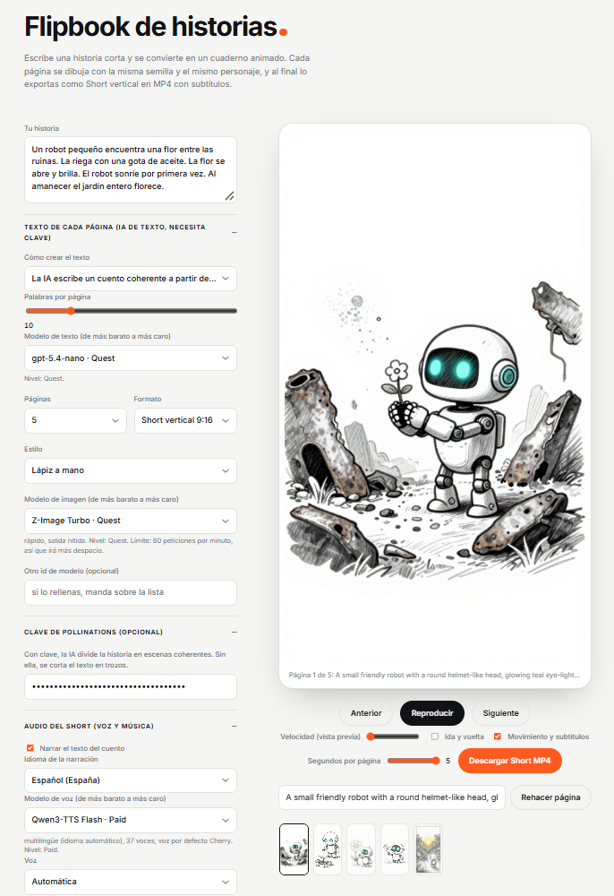

# 📖 Flipbook Mini Truyện – Truyện hoạt hình bằng AI

> 🌐 **Ngôn ngữ:** [Tiếng Việt](README.vi.md) · [Español (bản gốc)](README.md)
>
> Bản dịch tiếng Việt này được giữ **tách riêng** khỏi file gốc `README.md` (tiếng Tây Ban Nha của tác giả) để bạn vẫn có thể đồng bộ fork từ tác giả mà không bị xung đột. Tương tự, giao diện tiếng Việt nằm ở `index.vi.html`, còn `index.html` là bản gốc.

Viết một câu chuyện ngắn và nó sẽ biến thành một **cuốn sách hoạt hình**: mỗi trang được vẽ bằng AI với cùng một nhân vật và cùng một phong cách, và cuối cùng bạn xuất ra thành **Short dọc MP4** với phụ đề, giọng đọc và nhạc nền. Hoàn hảo cho TikTok, YouTube Shorts và Instagram Reels.

👉 **Trang của tác giả:** [belumoka.com/flipbook-generator](https://belumoka.com/flipbook-generator/) · **GitHub Pages của tác giả:** [belumokasl-hub.github.io/flipbook-mini-historias](https://belumokasl-hub.github.io/flipbook-mini-historias/)

🌐 **Hoặc dùng trực tiếp trên GitHub Pages (fork này):**
- Bản tiếng Việt: [khanhlx6.github.io/flipbook-mini-historias/index.vi.html](https://khanhlx6.github.io/flipbook-mini-historias/index.vi.html)
- Bản gốc (tiếng Tây Ban Nha): [khanhlx6.github.io/flipbook-mini-historias](https://khanhlx6.github.io/flipbook-mini-historias/)

---

## ✨ Cách hoạt động

| Bước | Diễn ra điều gì |
|---|---|
| ✍️ Bạn viết một ý tưởng | Ví dụ: *"Một chú cáo nhỏ tìm thấy đèn lồng trong rừng…"* |
| 🧠 AI tạo câu chuyện | Chia thành các trang với mở đầu, nút thắt và kết thúc (dùng khóa Pollinations) |
| 🎨 Vẽ từng trang | Cùng một hạt giống (seed) và cùng một nhân vật ở tất cả các trang để câu chuyện nhất quán |
| ▶️ Bạn xem lại | Xem trước dạng flipbook, từng trang một hoặc lặp đi lặp lại (ping-pong) |
| 🔁 Làm lại phần không ưng | Chọn một trang, đổi mô tả của nó và nhấn **Làm lại trang** |
| 🎬 Tải Short | MP4 với hiệu ứng chuyển động, phụ đề, giọng đọc và nhạc |

## 🖌️ Các phong cách có sẵn

| Phong cách | Hình thức |
|---|---|
| ✏️ Bút chì vẽ tay | Phác thảo đen trắng, nét đơn giản |
| 🎨 Màu nước truyện cổ tích | Minh họa mềm mại như sách thiếu nhi |
| 👾 Pixel art | 16 bit, bảng màu giới hạn |
| 💥 Truyện tranh | Mực đậm, màu phẳng |
| 🧸 Đất sét stop-motion | Nhân vật bằng đất sét |

## 📁 Các file

| File | Dùng để làm gì |
|---|---|
| `index.html` | Flipbook đầy đủ (bản gốc tiếng Tây Ban Nha): mở file này là chạy, không cần cài đặt gì |
| `index.vi.html` | Flipbook giao diện tiếng Việt: mở file này là chạy, không cần cài đặt gì |
| `README.md` | Hướng dẫn này (bản gốc tiếng Tây Ban Nha của tác giả, giữ nguyên để đồng bộ fork) |
| `README.vi.md` | Bản dịch tiếng Việt của hướng dẫn |
| `LICENSE` | Giấy phép MIT |

## 📋 Yêu cầu

- Một trình duyệt mới: **Chrome, Edge hoặc Safari** (để xuất MP4 có âm thanh)
- Kết nối internet
- *(Tùy chọn)* Kết nối tài khoản Pollinations bằng nút ở đầu trang để AI viết truyện, đọc giọng và tạo nhạc. Bạn thanh toán bằng Pollen của chính mình và tự quyết giới hạn; có thể ngắt kết nối bất cứ lúc nào. Phiên bản hiện tại không cần nhập tay khóa `sk_...` nữa.

## 🚀 Cách dùng

1. Mở `index.html` (bản gốc) hoặc `index.vi.html` (tiếng Việt) trong trình duyệt (hoặc mở trang trực tuyến ở trên).
2. Viết câu chuyện của bạn hoặc để nguyên ví dụ về chú cáo.
3. Chọn **số trang**, **định dạng** (9:16 cho Shorts) và **phong cách**.
4. Nhấn **Tạo flipbook** và chờ các trang được vẽ.
5. Nhấn **Phát** để xem.
6. Nhấn **Tải Short MP4** để tải video xuống.

## ⚙️ Cài đặt

| Tùy chọn | Tác dụng |
|---|---|
| Cách tạo văn bản | AI viết truyện mới hoặc dùng văn bản của bạn nguyên trạng |
| Số từ mỗi trang | Độ dài của mỗi phụ đề (5–30 từ) |
| Số trang | Từ 4 đến 24 |
| Định dạng | Short dọc 9:16, hình vuông hoặc ngang 16:9 |
| Mô hình hình ảnh / văn bản / giọng đọc / nhạc | Sắp xếp từ rẻ nhất đến đắt nhất |
| Ngôn ngữ đọc | Tiếng Tây Ban Nha, tiếng Anh, tiếng Pháp, tiếng Bồ Đào Nha và nhiều ngôn ngữ khác (bao gồm tiếng Việt) |
| Chuyển động và phụ đề | Zoom nhẹ giữa các trang và chữ lớn trong video |
| Giây mỗi trang | Thời lượng tối thiểu của mỗi trang trong video |

## 🛠️ Vấn đề thường gặp

| Vấn đề | Cách giải quyết |
|---|---|
| Một trang hiện màu đỏ hoặc "bị lỗi" | Chọn trang đó và nhấn **Làm lại trang**, hoặc đổi mô hình hình ảnh |
| "Không có khóa thì không thể viết truyện mới" | Không có kết nối thì sẽ chia văn bản của bạn nguyên trạng. Hãy kết nối tài khoản Pollinations để AI viết truyện |
| Video tải xuống không có âm thanh | Dùng Chrome, Edge hoặc Safari mới nhất |
| Chạy rất chậm | Một số mô hình có giới hạn số yêu cầu mỗi phút: hãy chọn mô hình nhanh hơn |
| Giọng đọc không phát | Nhấn **Thử giọng đọc**, đổi giọng hoặc để "Tự động" |

## 🔒 Quyền riêng tư

Khóa / phiên kết nối Pollinations **chỉ được lưu trong trình duyệt của bạn** (localStorage). Không bao giờ được tải lên kho mã nguồn hay bất kỳ máy chủ nào khác.

## 💡 Mẹo cho Shorts của bạn

Những câu chuyện ngắn với một nhân vật rõ ràng (một con vật, một vật phẩm ma thuật, một cú bẻ lái ở cuối) sẽ cho kết quả tốt nhất. Dùng **12 trang ở 9:16** với tính năng đọc bật: bạn sẽ có một Short khoảng 30 giây, lý tưởng cho mạng xã hội.

## 🚀 Triển khai lên GitHub Pages (fork này)

Trang live: [https://khanhlx6.github.io/flipbook-mini-historias/](https://khanhlx6.github.io/flipbook-mini-historias/)

Workflow `.github/workflows/static.yml` tự động deploy khi bạn push lên nhánh `main`:

1. Vào **Settings → Pages → Source = GitHub Actions** (đã bật sẵn cho fork này).
2. Push hoặc merge vào `main` — GitHub Actions sẽ chạy workflow *Deploy static content to Pages*.
3. Mở lại URL ở trên sau vài phút. Bản tiếng Việt ở `/index.vi.html`.

> Lưu ý đồng bộ fork: `README.md` và `index.html` là file gốc của tác giả — giữ nguyên để khi bạn **Sync fork** từ tác giả sẽ không xung đột. Mọi tùy chỉnh tiếng Việt nằm ở `README.vi.md` và `index.vi.html`.

---

Được tạo bởi **[Belumoka](https://belumoka.com)** · Hình ảnh, giọng đọc và nhạc được tạo bằng [pollinations.ai](https://pollinations.ai/?ref=badge) · Bản dịch tiếng Việt cho fork `khanhlx6/flipbook-mini-historias`
